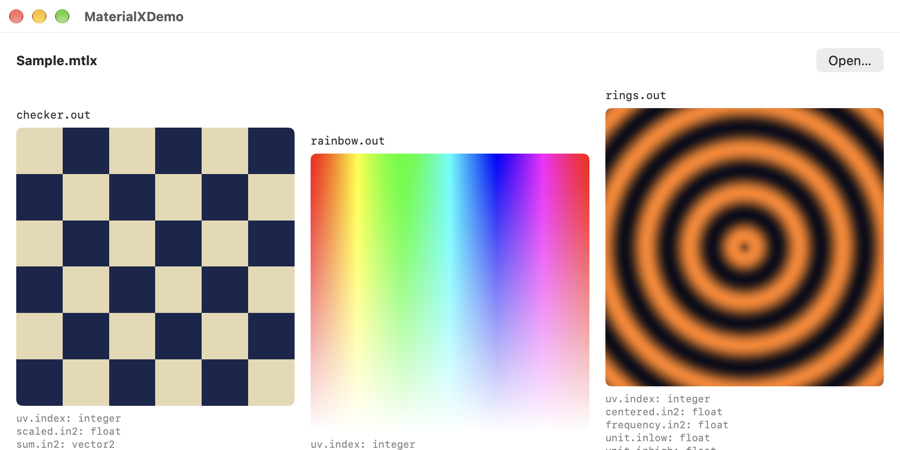

# MaterialXDemo

Loads a `.mtlx` file, stitches every color output of its nodegraphs, and draws each on a quad with
`MaterialXUnlitSurface`. Under each quad is the stitch report: the graph's parameters, or why it could not be stitched.
The file is watched (`DocumentWatcher`): save it and the outputs re-stitch, keeping parameter values changed at run time.

It opens `Packages/MaterialXDemoSupport/Sources/MaterialXDemoSupport/Resources/Sample.mtlx`; **Open…** picks another file.



```sh
xcb build -d mac   # from this folder
```
